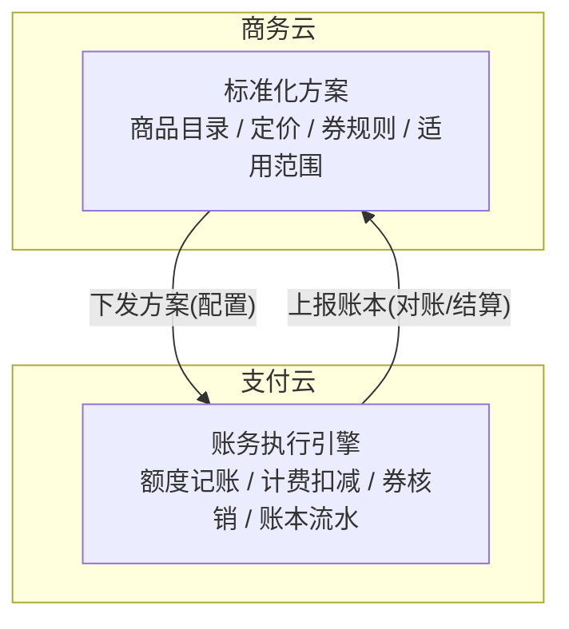

# 三业务计费同构:单价 × 数量与行模型

根据 2026-08-03 支付工程日志（[journal](../journal/default/2026-08-02.md)）的「新发现」展开的一次深入讨论,沉淀为四条洞察:计费本质、同构根源、工程化落点、实施策略。

## 0. 洞察的由来

日志中的新发现:

> 我们的数据和课程这两个业务,其计费模式和云是同构的。在设计它们的时候,就是按照云的按量计费模式去设计的。这是我们计费模式很大的一个特点,几个业务居然是同构的。

三业务的表象差异(价格量级、消费频率)掩盖了底层结构的同一性。深入讨论后,这个"发现"被拆解为四个层次递进的洞察。

## 1. 洞察一:计费的本质是「单价 × 数量」

三个业务在计费公式上退化成同一个表达式:

| 业务 | 单价 | 数量 | 典型量级 | 消费频率 |
|------|------|------|----------|----------|
| 量潮云(PaaS) | 单价 × 资源用量 | 多次小额事件 | 3 元 / 2 元 / 5 元级 | 高,连续计量 |
| 量潮课堂 | 单价 × 课时数 | 学一节扣一节 | 100 元/节、150 元/系列课 | 中,按学习进度 |
| 量潮数据 | 单价 × 1 | 单次用量事件 | 8000 元 | 低,一次性大额 |

无优惠时:`应付 = 单价 × 数量`。

**复杂度不在乘法本身,而在"单价"与"数量"的确定过程**:

- **单价不是常数**:阶梯价(量大单价低)、折扣价、套餐折算——单价本身是一个函数
- **数量不是计数**:计量口径("一个课时"与"一个资源小时"的口径完全不同)、最小计量单位、舍入规则
- **优惠让 f 非线性**:满减是阈值函数,代金券是固定额抵扣 + 不找零截断,券→代金券→余额的优先级是排序问题——这些都不是乘法能表达的

正式表达:`应付 = f(商品, 数量, 优惠规则)`,无优惠时 f 退化为 `单价 × 数量`。

## 2. 洞察二:同构的根源是分层架构,而非巧合

同构成立不是三个业务碰巧相似,而是上层架构的必然:

- **商务云负责"方案是什么"**:卖什么、定价规则、营销规则——即"单价 × 数量"的模板
- **支付云负责"方案怎么执行"**:额度、扣费、核销、账本——即模板的实例
- 支付云看到的不是三个不同的业务,而是**同一套模板的三个实例**(参数不同:单价、券规则、适用范围)

推论:同构性不需要再论证(上层已经标准化),支付云的价值重心转移到**执行引擎本身的可靠性**与**对模板变化的适应性**上。

## 3. 洞察三:工程化落点是行模型(line item)

比"单价 × 数量"更值得统一的抽象是**行**。计量、计费、结算、账本,四个环节全是行:

- 一次扣费 = 一行明细:`商品 × 数量 × 单价`
- 一张券 = 一行折扣:`coupon: 2000`
- 一张代金券 = 一行抵扣:`voucher: 2000`
- 余额支付 = 一行余额行:`balance: 7000`
- 一笔交易 = 账本行:`balance_after` 连续

`tests.md` 的明细格式 `[{coupon:2000},{voucher:2000},{balance:7000}]` 已经是行模型——**每笔扣费就是一行或多行的组合,券、代金券、余额都是行**。

行模型的可扩展性:

| 未来需求 | 行模型表达 |
|----------|-----------|
| 退款 | 负数量/负金额行 |
| 分期付款 | 一行摊成多行 |
| 订阅制 | 时间维度的行(月费 × 月数 = 单价 × 数量) |
| 套餐打包 | 内部拆成多行 |

**支付云引擎因此不需要理解业务**:接收方案 → 拆行 → 优惠变换 → 求和结算 → 写账本。商务云下发方案的契约,本质上就是"教支付云怎么把一笔消费拆成行"。

## 4. 洞察四:抄结构,不抄复杂度

行模型、账本、券体系在业界都有成熟范式,应当借鉴结构而砍掉复杂度。

**要抄的成熟体系**:

| 层 | 抄谁 | 抄什么 |
|----|------|--------|
| 账本核心 | 银行核心系统 / 复式记账 | 借贷分录、分户账、余额 = 流水求和 |
| 明细行模型 | AWS CUR / 阿里云账单明细 | 账单即行表:商品 × 数量 × 单价 + 折扣行 |
| 券与营销 | 微信支付代金券 / 支付宝营销体系 | 批次发放、核销、门槛、过期、适用范围 |
| 对账 | 支付机构 T+1 对账 | 对账单、差错处理、账实核对 |
| 预付费 | 预付卡体系 | 额度、有效期、余额管理(合规部分暂可忽略) |

**坚决不抄的两层**(成熟体系里最复杂、当前最不需要的部分):

1. **规则引擎**:电信 BSS 的计费规则引擎、可编排定价引擎——当前是"单价 × 数量 + 几个券",硬编码 + 数据表即可
2. **支付通道抽象**:支付路由、网关、清结算——已决定模拟账户先行,支付对接本就后置

**复杂度押注原则**:规则简单 → 复杂度押在**账本可靠性**(不丢、不重、不错、可查),而非**计费灵活性**。

## 5. 决策影响

1. **支付云定位为纯执行引擎**,业务差异全部参数化;计费规则、券优先级、满减力度由商务云在方案层定义,支付云忠实执行
2. **分层契约要明确**:方案配置的下发接口(商品目录、计费规则、券策略、适用范围)+ 账本数据的上报接口(对账、结算报表回给商务云)
3. **不做可配置规则引擎**:规则简单,用硬编码 + 数据表承载;等商务云下发订阅制、阶梯价等复杂模板时,再在行模型上长规则引擎
4. **演进路径顺畅**:行模型的结构不变,变化只是"怎么拆行、怎么变换",因此规则复杂化的演进不会推翻账本核心

## 6. 与既有领域模型的关系

与 [model.md](./model.md) 的对应:账户、交易、余额、优惠券、代金券、计费规则、订单是领域的业务概念,行模型是这些概念的**底层统一**:

- 账户余额 = 行流水的投影
- 交易 = 行的不可变落账
- 计费规则 = "如何把消费拆成行、如何变换行"的规则
- 优惠券/代金券 = 行变换的输入(生成折扣行/抵扣行)

对 model.md「演化洞见」的补充:手动登记 → 系统化记录 → 自动化执行三个阶段中,模型不变、变的只是交易来源;行模型视角下同样成立——**变的只是"行从哪来"(人工录入、规则生成、支付回调),行本身的结构不变**。

这也解释了日志的反直觉点:模拟账户先行是安全的,因为账本核心就是行的流水账,接不接支付系统都不影响它成立。

## 7. 开放问题(待验证)

1. **同构的自我实现成分**:设计时就按云的按量计费模式套用,验收时发现同构——部分是预期的。真正的考验是未来需求冲击下同构是否稳固
2. **什么会打破同构**:学期卡/年卡(课时包)、数据服务订阅制、阶梯价/承诺消费、退款与部分退款、跨行聚合优惠(满 X 订单送 Y)
3. **模板变化对支付云的影响面**:商务云新增一种方案模板时,支付云需要改多少?这决定支付云把哪层抽象成数据、哪层抽象成代码
4. **层边界的仲裁**:满减力度选择、代金券不找零这类规则,属于商务云的方案策略还是支付云的执行语义?建议:策略归商务云,执行归支付云
