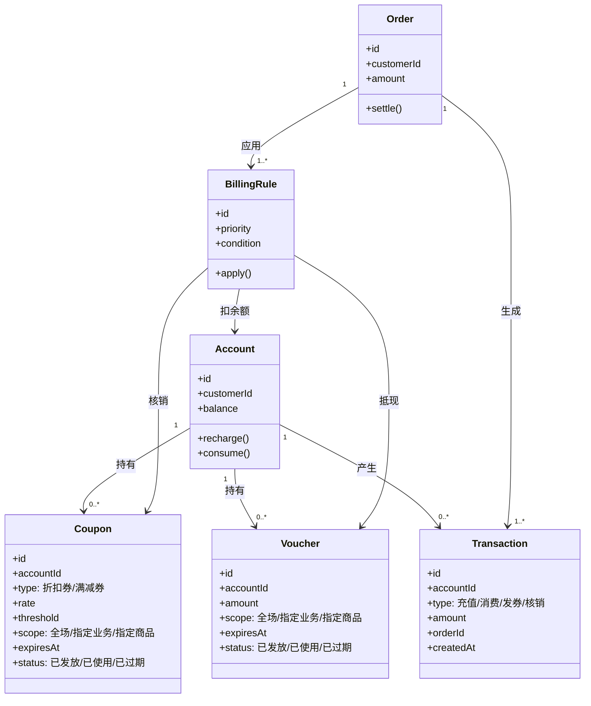
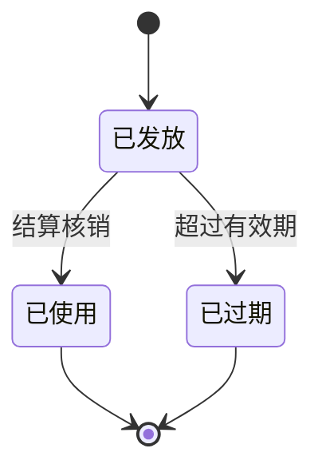

# 量潮支付工程的领域模型

根据 2026-08-03 支付工程意图（[intention](../intention/index.md)）的建模。

## 建模原则

从意图推导出三条原则：

1. **模型的核心不是钱，而是交易事实**——交易、余额、优惠券/代金券的当前状态，以及保证这些状态一致性的机制
2. **先建模拟账户，再对接支付**——模型先行，支付通道是后接的可替换层，这决定了模型的边界
3. **账本一定要清楚**——与业务活动直接相关的支付行为、与客户之间的交易行为，都要落在账本上

## 核心概念

### 账户（Account）

客户在我们这里的虚拟钱包。意图中的「对公打款后往账户里充钱」直接对应账户的充值动作。账户是客户交易事实的载体。

### 交易（Transaction）

每一笔客户交易的不可变记录：充值、发券、核销、消费。交易是账本，回答「这笔交易是否可靠」——不丢、不重、可查都落在交易上。

### 余额（Balance）

账户当前可用资金的当前事实。余额由交易推导而来，是交易的投影，因此必须与交易一致（不错）。

### 优惠券（Coupon）

按规则抵扣的优惠手段，关注「什么时候用」。优惠券本身**不代表钱**，它是一条规则：

- 折扣券：按比例优惠（如 9 折），力度是折扣比例
- 满减券：满足门槛后减额（如满 100 减 20），门槛与减额构成力度
- 使用时机由计费规则决定，结算时不直接抵现

属性：

- 适用范围：全场通用 / 指定业务（云服务、课程、数据服务）/ 指定商品
- 有效期：过期后不可用
- 状态：已发放 / 已使用 / 已过期

### 代金券（Voucher）

直接抵现的优惠手段，关注「优先于余额吗」。代金券本身**就是钱**：

- 面值固定，等价于现金，结算时直接抵减应付款项
- 与余额一样代表「钱」，结算先后由计费规则决定

属性：

- 适用范围：全场通用 / 指定业务（云服务、课程、数据服务）/ 指定商品
- 有效期：过期后不可用
- 状态：已发放 / 已使用 / 已过期

### 计费规则（Billing Rule）

决定一笔消费如何结算：优惠券什么时候用、代金券是否优先于余额、力度如何。不同业务计费模式不同——云服务按量计费、课程几十到几百元、数据服务几千元——因此计费规则是模型中最易变的部分。

### 订单（Order）

客户购买付费服务的交易请求。订单在结算时应用计费规则，生成交易，更新余额与对应优惠状态。

## 模型图

优惠券与代金券共享的生命周期（各自独立维护）：

## 关键场景

1. **充值**：对公打款 → 登记入账 → 账户余额增加，生成充值交易
2. **发券**：直接发放优惠券或代金券 → 对应状态为「已发放」
3. **消费**：客户购买付费服务 → 计费规则决定抵扣顺序（优惠券、代金券、余额的先后）→ 生成消费交易 → 更新余额与对应优惠状态
4. **对账**：余额与交易对得上、交易可追溯，是「不错、可查」的落地

## 与意图的对应

| 意图 | 模型要素 |
|------|----------|
| 不接入支付先完成支付 | 账户 + 充值交易（对公打款入账） |
| 余额和优惠形式是重点 | 余额、优惠券/代金券 |
| 账本一定要清楚 | 交易账本（不可变记录） |
| 计费规则微妙 | 计费规则（时机、优先级、力度） |
| 先建模拟账户再对接支付 | 账户模型先行，支付通道作为后接层 |

## 演化洞见

从手动到自动的三个阶段中，**模型不变，变的只是交易的来源**：

1. 手动登记：交易由人工登记产生
2. 系统化记录：交易由系统规则产生
3. 自动化执行：交易由支付回调产生

这解释了「反直觉点」：先建模拟账户模型是安全的，因为支付对接只改变交易的产生方式，不改变账本本身。
